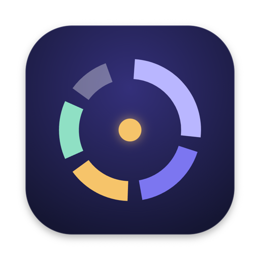
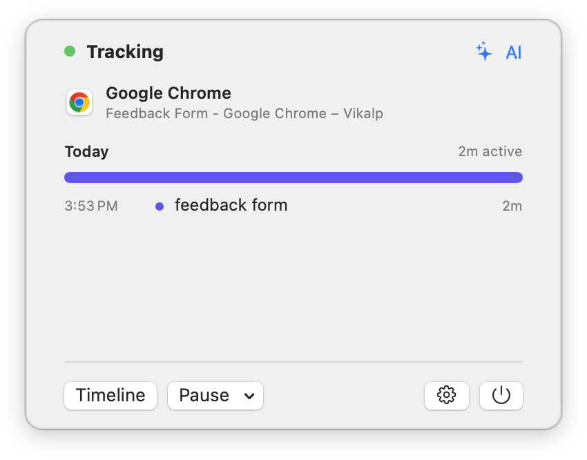
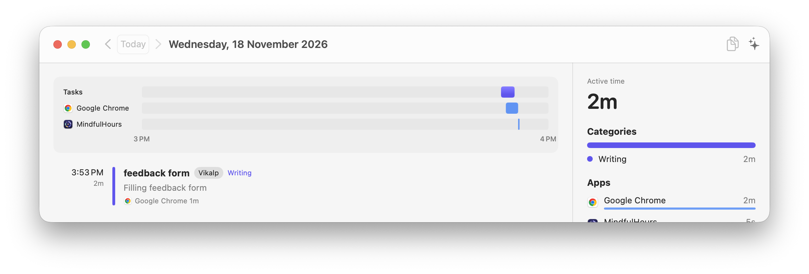
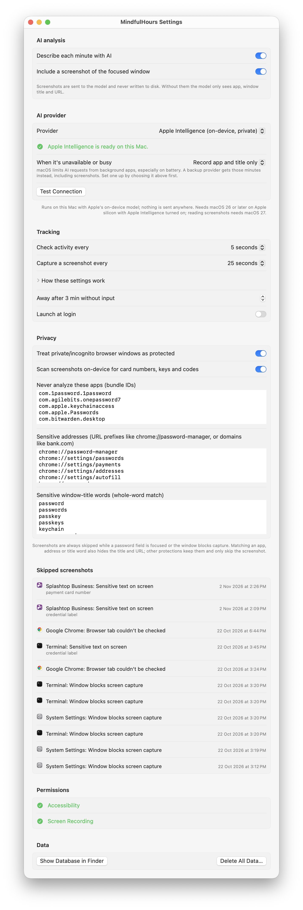

<p align="center">
  
</p>

<h1 align="center">MindfulHours</h1>

<p align="center">
  <strong>Know where your hours go.</strong><br>
  A privacy-first macOS menu-bar journal of what you actually work on, minute by minute — including what you do <em>inside</em> each app.
</p>

<p align="center">
  <a href="https://github.com/VikalpP/MindfulHours/releases/latest"></a>
  <a href="https://github.com/VikalpP/MindfulHours/actions/workflows/ci.yml"></a>
  
  
  <a href="LICENSE"></a>
</p>

<p align="center">
  <a href="#screenshots">Screenshots</a> ·
  <a href="#install">Install</a> ·
  <a href="#how-it-works">How it works</a> ·
  <a href="#privacy">Privacy</a> ·
  <a href="#ai-providers">AI providers</a> ·
  <a href="CONTRIBUTING.md">Contributing</a>
</p>

<p align="center">
  <picture>
    <source media="(prefers-color-scheme: dark)" srcset="docs/screenshots/menu-dark.png">
    
  </picture>
</p>

---

Ever reach 6 pm and wonder where the day went? MindfulHours sits in your menu bar and keeps an honest, specific log — not just *"Chrome, 3 h"*, but *"Reviewing PR #42 auth refactor in acme/api"*, *"Debugging token refresh in session.ts"*, *"Watching a Stanford lecture on agents"*. At the end of the day it writes your work log for you.

- **Minute-by-minute timeline** of tasks, grouped into focus blocks with projects and categories
- **In-app understanding** via an AI model of your choice — sign in with ChatGPT or OpenRouter, add a Claude, OpenAI or Gemini key, or run one locally with Ollama or LM Studio
- **Privacy-first**: password fields, password-manager pages, private windows and on-screen secrets are never captured; screenshots never touch disk
- **Daily summary** and one-click **Markdown export** for standups
- **Local data**: everything lives in a SQLite file on your Mac

## Screenshots

<table>
  <tr>
    <th>Timeline</th>
    <th>Settings</th>
  </tr>
  <tr>
    <td valign="top">
      <picture>
    <source media="(prefers-color-scheme: dark)" srcset="docs/screenshots/timeline-dark.png">
    
  </picture>
    </td>
    <td valign="top">
      <picture>
    <source media="(prefers-color-scheme: dark)" srcset="docs/screenshots/settings-dark.png">
    
  </picture>
    </td>
  </tr>
</table>

The Timeline's **app lanes** show how you moved between apps across the day; each task block lists every app used in it. Screenshots follow your GitHub light/dark theme. Regenerate them with `scripts/take-screenshots.sh`.

## Install

1. Download the latest **MindfulHours DMG** from [Releases](https://github.com/VikalpP/MindfulHours/releases/latest) and drag MindfulHours to **Applications**.
2. Releases aren't notarized yet, so macOS blocks the first launch: open the app once, then go to **System Settings › Privacy & Security** and click **Open Anyway**. (Or run `xattr -dr com.apple.quarantine /Applications/MindfulHours.app`.)
3. Grant **Accessibility** (window titles) and **Screen Recording** (in-app context) when asked, then reopen the app. Allow **Automation** for each browser the first time it's in front, so the active tab's URL can be read.
4. Optional: set up AI descriptions (below). Without it, minutes are still recorded from app, window title and URL.

Prefer building from source? See [CONTRIBUTING.md](CONTRIBUTING.md#development-setup).

## How it works

| Layer | Source | Cadence |
|---|---|---|
| Frontmost app, window title, open document | `NSWorkspace` + Accessibility API | every 5 s (configurable) |
| Active tab URL (Safari, Chrome, Comet, Arc, Brave, Edge, Vivaldi, Opera) | AppleScript | every activity check |
| Away detection | input idle time, screen lock, sleep; video/call apps holding a display-sleep assertion count as present | every activity check |
| Screenshot of the focused window | ScreenCaptureKit, kept in memory only | every 25 s (configurable) |
| "What are you doing in the app?" | the AI provider you pick in Settings | once per active minute |

macOS has no API for what happens inside an app, so each active minute MindfulHours sends the window metadata and (when allowed) a screenshot of the focused window to the model, which returns a specific summary, a task label, project and category. Consecutive minutes on the same task merge into blocks on the timeline.

A minute whose window and screenshot haven't changed reuses the previous description (64-bit perceptual hash, refreshed at least every 10 minutes), which keeps model calls down. When AI is off or unreachable, minutes are still recorded from metadata; failures back off up to 15 minutes.

## Privacy

Before every screenshot, MindfulHours checks these signals. Any hit means **no screenshot**:

| Signal | Detected via | Title & URL |
|---|---|---|
| Excluded app (password managers by default) | bundle ID list | hidden |
| Sensitive address (`chrome://password-manager`, `edge://wallet`, `passwords.google.com`, your bank…) | active tab URL vs. editable prefix/domain list | hidden |
| Sensitive title word ("passwords", "recovery codes", "credit card"…, whole-word) | window title vs. editable list | hidden |
| Password field focused | secure event input + Accessibility `AXSecureTextField` | kept |
| Window opts out of capture | `kCGWindowSharingState == none` | kept |
| Private/incognito window | Chromium `mode` property; Safari Window-menu check | kept (toggle) |
| Browser state can't be read | URL or private-mode check failed | kept |
| Secrets on screen (card numbers, IBANs, SSNs, API keys, private keys, recovery codes) | on-device Vision OCR | kept |

- When the title or URL is itself sensitive, the minute is stored as *"App — private content hidden"* and nothing goes to the model. Otherwise the model receives only the metadata and is told the screenshot was withheld.
- A page that was protected at any point in a minute never contributes a screenshot to that minute, and every capture is re-checked against the current window after it completes.
- Screenshots wait until the on-device text scanner has loaded (up to ~30 s after a reboot), so none skip the scan.
- Every skip is logged (reason and matched rule, never the content) under **Settings › Skipped screenshots**.
- Data lives in `~/Library/Application Support/MindfulHours/activity.sqlite`. Screenshots are never written to disk. The only network traffic is to the AI provider you choose (and its sign-in page when you connect it); with Ollama or LM Studio nothing leaves your Mac.

Found a way around these protections? Please report it privately — see [SECURITY.md](SECURITY.md).

## AI providers

Pick a provider under **Settings › AI provider**, connect it, and choose a model from the list. The model must accept images if screenshots are enabled.

| Provider | How you connect | Cost |
|---|---|---|
| ChatGPT | **Sign in with ChatGPT** in your browser | counts toward your ChatGPT plan's usage |
| OpenRouter | **Sign in with OpenRouter**; creates a key you can limit or revoke | pay per request on OpenRouter |
| Claude, OpenAI API, Gemini | paste an API key (Settings links to where to create one) | pay per request |
| Ollama, LM Studio | nothing; MindfulHours finds the server on this Mac | free, nothing leaves your Mac |
| Custom | any OpenAI-compatible **Base URL**, optional **API key** | depends on the endpoint |

Keys and sign-ins are stored in your macOS Keychain. Small, fast models work best at one call per active minute (Claude Haiku, a GPT "mini" model, Gemini Flash, or a local vision model such as `gemma3`).

**Advanced: route through [CLIProxyAPI](https://github.com/router-for-me/CLIProxyAPI)** as a Custom endpoint, which runs locally and can front several subscriptions behind one URL:

```sh
curl -fsSLO https://raw.githubusercontent.com/VikalpP/MindfulHours/main/scripts/setup-proxy.sh
less setup-proxy.sh   # review it first
bash setup-proxy.sh   # installs cliproxyapi via Homebrew, signs in, sets MindfulHours to the Custom provider
```

It binds the proxy to `127.0.0.1`, generates a local API key, and picks `claude-haiku-5-5` (fast and cheap at one call per active minute).

## Using it

- **Menu bar** — what you're doing now, today's active time and categories, recent blocks, pause for 15 min / 1 h / until resumed. A shield icon means the current window is protected.
- **Timeline window** — app lanes showing how you moved between apps across the day, then every task block with its minute-level details and the apps used in it, plus time per app and category, **Summarize Day** and **Copy Markdown**.
- **Settings** — AI provider (sign-in, API key or local) and model with connection test, screenshot and text-scan toggles, privacy rules, skipped-screenshot log, idle threshold, launch at login, delete all data.

## Contributing

Contributions are welcome — see [CONTRIBUTING.md](CONTRIBUTING.md) for setup, architecture and the PR process, and [CODE_OF_CONDUCT.md](CODE_OF_CONDUCT.md).

## License

[MIT](LICENSE) © Vikalp Panseriya
